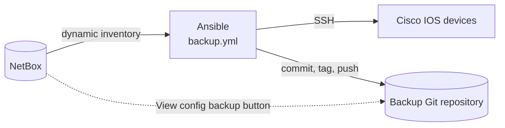

# netbox-config-backup

[](LICENSE)
[](https://docs.ansible.com/)
[](https://netboxlabs.com/docs/netbox/)

Automated configuration backups for Cisco IOS devices, driven by [NetBox](https://github.com/netbox-community/netbox) as the source of truth and versioned in Git.

Each run collects the running configuration of every NetBox device tagged for backup, commits the changes to a Git repository, and tags the day's snapshot. A NetBox custom link adds a **View config backup** button to each device page, so engineers can go from the inventory straight to the latest configuration.

## Contents

- [How it works](#how-it-works)
- [Features](#features)
- [Requirements](#requirements)
- [Quick start](#quick-start)
- [NetBox configuration](#netbox-configuration)
- [Configuration reference](#configuration-reference)
- [Usage](#usage)
- [CI/CD](#cicd)
- [Repository layout](#repository-layout)
- [Security considerations](#security-considerations)
- [Troubleshooting](#troubleshooting)
- [Contributing](#contributing)
- [License](#license)

## How it works



1. The `netbox.netbox.nb_inventory` plugin loads every **active** device tagged **`backup`** and groups devices by platform.
2. `backup.yml` clones the backup repository and saves each device's running configuration as `<hostname>.txt`.
3. Changes are committed, the commit is tagged with the date (`YYYY-MM-DD`), and everything is pushed.
4. A NetBox custom link opens the device's file in your Git host's web interface.

## Features

- **NetBox as the source of truth**: no static inventory files to maintain.
- **Git history for every device**: diff any two days, and every snapshot is tagged.
- **Fails loudly**: a device that can't be reached, or a push that fails, makes the run exit non-zero, while the backups that succeeded are still committed.
- **No secrets in the repository**: credentials come from environment variables or your CI platform's secret store.
- **Ready-made pipelines** for GitHub Actions, GitLab CI/CD, Azure Pipelines and Jenkins.
- **Works with any Git host**: GitHub, GitLab, Azure Repos, Bitbucket, Gitea/Forgejo.

## Requirements

| Component | Version | Notes |
|-----------|---------|-------|
| Python | 3.11+ | Required by `netbox.netbox`; the latest ansible-core needs 3.13+ |
| ansible-core | 2.18+ | Required by `netbox.netbox` |
| `netbox.netbox` collection | 3.23+ | Dynamic inventory plugin |
| `cisco.ios` collection | 11.6+ | |
| `ansible.netcommon` collection | 8.7+ | `network_cli` connection and `enable` become plugin |
| NetBox | 4.x | `netbox.netbox` supports the two most recent NetBox releases |

You also need:

- a NetBox API token (read-only is sufficient for the inventory plugin);
- a Git repository for the backups that already has at least one commit (for example a README), so it has a default branch to push to;
- network access from the machine running Ansible to NetBox and to the devices' SSH ports.

## Quick start

```sh
# 1. Clone and install dependencies
git clone https://github.com/fsantos00/netbox-config-backup.git
cd netbox-config-backup
python3 -m venv .venv && . .venv/bin/activate
pip install -r requirements.txt
ansible-galaxy collection install -r collections/requirements.yml

# 2. Provide connection details
export NETBOX_API="https://netbox.example.com"
export NETBOX_TOKEN="<netbox-api-token>"
export NET_USER="<device-username>"
export NET_PASSWORD="<device-password>"
export BACKUP_REPO_URL="https://<user>:<token>@github.com/<owner>/<backups-repo>.git"

# 3. Check the inventory, then run the first backup
ansible-inventory --graph
ansible-playbook backup.yml
```

## NetBox configuration

### Devices

| Setting | Requirement |
|---------|-------------|
| Platform | Slug `ios`. If yours differs (e.g. `cisco-ios`), rename `group_vars/ios.yml` to match and update `hosts:` in the playbooks. |
| Status | `Active` |
| Tag | `backup`. Create it under *Customization > Tags* and assign it to every device to back up. |
| Address | The primary IP is used by default. To use a different address, create a device custom field named `management_ip` (type *Text*); it takes precedence when set. |

The status and tag filters are defined in [`netbox_inventory.yml`](netbox_inventory.yml).

### "View config backup" button

Create a [custom link](https://netboxlabs.com/docs/netbox/customization/custom-links/) under *Customization > Custom Links*:

| Field | Value |
|-------|-------|
| Name | `View config backup` |
| Object types | `DCIM > Device` |
| Link text | `View config backup` |
| Link URL | See the table below |
| Button class | Any, e.g. *Blue* |
| New window | Enabled |

NetBox hides custom links whose text renders empty, so the button only appears on devices tagged `backup`.

Backup files are named after the Ansible inventory hostname. For stacked switches (virtual chassis) that is the virtual chassis name, and the templates below handle both cases. Replace the placeholders in angle brackets with your own values.

| Git host | Link URL |
|----------|----------|
| GitHub | `https://github.com/<owner>/<repo>/blob/<branch>/{{ object.virtual_chassis.name if object.virtual_chassis else object.name }}.txt` |
| GitLab | `https://gitlab.com/<owner>/<repo>/-/blob/<branch>/{{ object.virtual_chassis.name if object.virtual_chassis else object.name }}.txt` |
| Azure Repos | `https://dev.azure.com/<org>/<project>/_git/<repo>?path=/{{ object.virtual_chassis.name if object.virtual_chassis else object.name }}.txt` |
| Bitbucket | `https://bitbucket.org/<owner>/<repo>/src/<branch>/{{ object.virtual_chassis.name if object.virtual_chassis else object.name }}.txt` |
| Gitea / Forgejo | `https://<host>/<owner>/<repo>/src/branch/<branch>/{{ object.virtual_chassis.name if object.virtual_chassis else object.name }}.txt` |

## Configuration reference

All runtime settings are read from environment variables.

| Variable | Required | Description |
|----------|:--------:|-------------|
| `NETBOX_API` | Yes | NetBox base URL, e.g. `https://netbox.example.com` |
| `NETBOX_TOKEN` | Yes | NetBox API token |
| `NET_USER` | Yes | Device SSH username |
| `NET_PASSWORD` | Yes | Device SSH password |
| `NET_ENABLE_PASSWORD` | No | Enable secret; defaults to `NET_PASSWORD` |
| `BACKUP_REPO_URL` | Yes | Clone URL of the backup repository: HTTPS with an access token, or SSH if the host has a deploy key |

Backups are written to `~/configs-backups`. To change the location, override the `backup_dir` variable, e.g. `-e backup_dir=/srv/backups`.

## Usage

| Command | Description |
|---------|-------------|
| `ansible-playbook backup.yml` | Back up all devices in the inventory |
| `ansible-playbook backup.yml --limit <hostname>` | Back up a single device |
| `ansible-playbook model.yml` | Print hostname, software image, model and serial numbers (useful when populating NetBox) |
| `ansible-inventory --graph` | Show the devices and groups loaded from NetBox |

## CI/CD

Every pipeline calls the same entry point, [`ci/run-backup.sh`](ci/run-backup.sh). It creates a virtual environment, installs the dependencies and runs `backup.yml`. Each pipeline runs daily at 02:00 and can also be started manually.

| Platform | Pipeline file | Where to store the secrets |
|----------|---------------|----------------------------|
| GitHub Actions | [`.github/workflows/backup.yml`](.github/workflows/backup.yml) | *Settings > Secrets and variables > Actions* |
| GitLab CI/CD | [`.gitlab-ci.yml`](.gitlab-ci.yml) | *Settings > CI/CD > Variables* (masked), plus a pipeline schedule |
| Azure Pipelines | [`azure-pipelines.yml`](azure-pipelines.yml) | *Pipelines > Library*, variable group `network-backup` |
| Jenkins | [`Jenkinsfile`](Jenkinsfile) | *Credentials* (Secret text): `netbox-api`, `netbox-token`, `net-user`, `net-password`, `backup-repo-url` |

> [!IMPORTANT]
> Network devices are normally reachable only from internal networks. Run these pipelines on a **self-hosted runner or agent** that can reach both NetBox and the devices.

Remove the pipeline files for the platforms you don't use.

## Repository layout

```text
.
├── backup.yml                 # Backup playbook (clone → backup → commit, tag, push)
├── model.yml                  # Hardware/inventory facts report
├── netbox_inventory.yml       # NetBox dynamic inventory definition
├── ansible.cfg
├── group_vars/
│   ├── all.yml                # Backup repository settings
│   └── ios.yml                # Cisco IOS connection settings
├── collections/requirements.yml
├── requirements.txt
├── ci/run-backup.sh           # Shared CI entry point
├── .github/workflows/backup.yml
├── .gitlab-ci.yml
├── azure-pipelines.yml
└── Jenkinsfile
```

## Security considerations

- **Credentials** are never stored in this repository. If you prefer file-based secrets, set them in `group_vars/ios.yml` and encrypt the file with [`ansible-vault`](https://docs.ansible.com/ansible/latest/vault_guide/index.html).
- **Backup contents are sensitive.** Device configurations can include SNMP communities, password hashes and keys. Keep the backup repository private and restrict who can access it.
- **Repository tokens** embedded in an HTTPS `BACKUP_REPO_URL` are stored in `~/configs-backups/.git/config` on the machine that runs the backup. Use a token scoped to that one repository.
- **SSH host keys:** `ansible.cfg` sets `host_key_checking = False` so new devices can be backed up without manual steps. Set it to `True` and pre-populate `known_hosts` if your security policy requires host key verification.
- **TLS:** the inventory validates NetBox's certificate. Set `validate_certs: false` in `netbox_inventory.yml` only for lab instances with self-signed certificates.

## Troubleshooting

| Symptom | Likely cause |
|---------|--------------|
| `ansible-inventory --graph` shows no `ios` group | Platform slug differs from `ios`, or devices are not `Active` / not tagged `backup` |
| Clone or push to the backup repository fails | `BACKUP_REPO_URL` is wrong, the token lacks write access, or the repository has no initial commit |
| Authentication or privilege errors on devices | Wrong `NET_USER` / `NET_PASSWORD`, or a separate enable secret is required (`NET_ENABLE_PASSWORD`) |
| Connection timeouts | The runner can't reach the device's SSH port, or `management_ip` / the primary IP is wrong in NetBox |

## Contributing

Issues and pull requests are welcome. Please keep changes focused, and run `yamllint` and `ansible-lint` before submitting.

## License

Released under the [MIT License](LICENSE).
